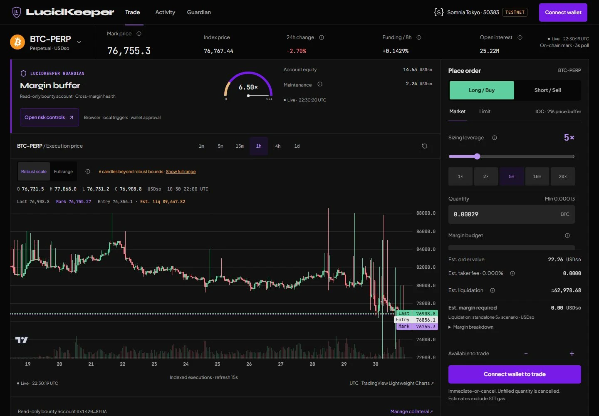

# LucidKeeper

## Perps execution. Risk in sight.

**A dreamDEX perps terminal, browser-local risk guardian and sourced trader portfolio on Somnia Tokyo testnet.**

Opening a position is only the first decision. LucidKeeper keeps market context, cross-margin health, reviewable actions and the resulting evidence in one workspace—so traders can follow the whole lifecycle.

**Testnet – no real funds.** Built for the **dreamDEX Perps Builder Bounty**, not Perps Arena. Tokyo **50383** · STT for gas · USDso for collateral.

[Public demo](https://lucid-keeper.vercel.app) · [Source](https://github.com/Handilusa/LucidKeeper) · [Project status](STATUS.md) · [Quality report](docs/LANDING_PROFILE_QUALITY.md) · [README prompt](docs/README_PROMPT.md)

**[Live test account — read-only](https://lucid-keeper.vercel.app/app/profile/0x1420cF8Bb9D92C3fDb674ECc5A57295c59078fDA)** · No funds or wallet connection required; never a default signer. Local route: `/app/profile/0x1420cF8Bb9D92C3fDb674ECc5A57295c59078fDA`. The new link/UI is local until the owner publishes this branch.

Trading on Tokyo testnet needs STT (gas) and USDso collateral distributed by the bounty program to whitelisted wallets. Any wallet holding those funds can connect and trade with LucidKeeper. Wallets without funds can explore in read-only mode.

**Do not use Arena funds.** Request missing Tokyo STT and Builder Bounty USDso from the official bounty team in Discord for your own whitelisted wallet. LucidKeeper does not distribute funds or offer a claim.

> **Delivery status — 31 October 2026:** the landing, dedicated portfolio and visual/motion passes are local on `feat/landing-and-profile`. The last independently checked production version is `0dce074` (30 October 15:43 UTC). New routes/features are not claimed as deployed; publication is owner-managed.

> **Current funding/UI checks — 31 October:** **88/88 Chromium**, **99 passed / 19 historical skipped / 0 failed** unit/service; app/E2E types, lint and build pass. Includes mobile/desktop zero-funds, read-failure, deposited-margin and read-only proof regressions. No push, deploy or live transaction in this update. [Current status](STATUS.md).

> **Earlier six-task release checks — 31 October (`755e6f3`):** independent Tokyo wallets, two-wallet lifecycle tests, address-scoped profiles and bounded read resilience are implemented. **79/79 Chromium**, **94 passed / 19 skipped / 0 failed** unit/service; types, lint and build pass. Prior publication check: 211 tracked paths, 13 documents, 103 local-link destinations, zero issues (not security certification). Dependencies remain **38 affected entries**; real second-wallet funding/fills and deployed parity require human QA. Static 240-request check is **not multi-user/RPC capacity certification**. [Audit](docs/PRE_PUSH_AUDIT.md) · [Deploy](docs/DEPLOYMENT.md).



*Historical, read-only terminal screenshot; its prices and balances are not live. [Original capture and metadata](public/assets/product/capture.json). The terminal retains its black/charcoal palette and violet accents.*

## What makes it useful

- **Context before execution.** Native execution candles, separate Last/Mark prices, verified market units, quantity/margin estimates and an unsigned transaction review.
- **Account-wide risk in view.** Cross-margin equity and maintenance, position context and clearly labeled stress/liquidation scenarios. A deposit is not an isolated loss cap.
- **A human-controlled Guardian.** Browser-local monitoring and exit requests. An active tab, fresh reads and wallet approval are required; reload disarms settings. It is not an always-on keeper.
- **Evidence after action.** Submission, confirmed transaction, actual fill and resulting position remain distinct. An explorer link does not turn a snapshot into a profit attestation.
- **A portfolio with sources.** Pinned current account reads, bounded indexed history, local aliases, sortable tables, CSV and share images. Unavailable financial inputs stay unavailable.

## A 60-second judge tour

Run the local build below, then visit:

| Route | Inspect |
| --- | --- |
| `/` | Product story, lifecycle, Somnia architecture, receipt trail and explicit limits. Every **Launch App** opens `/app`. |
| `/app` | Public market prices and candles without connection. Positions, balances, history and risk load only for the connected wallet. |
| `/app/profile` | Connected portfolio or explicit public-address lookup; no default demo account. |
| `/app/profile/:address` | Read-only public watch, address-scoped metrics/aliases/exports; never selects that address as signer. |
| `/app/docs` | Field guide: funding, lifecycle, data sources, operational boundaries and evidence. |

The persistent testnet badge applies to every route. Use **Pause motion** or your system’s reduced-motion preference to stop landing motion.

**No funds?** Use the Live test account, its sourced profile/history, public market reads, docs and the Proof below. Connecting an empty wallet shows exactly what is missing as a normal read-only state, separate from failed reads. Existing deposited margin and positions remain visible even if wallet USDso is zero. Guardian stress preview needs a real, freshly read position; without one, inspect the controls without a fabricated risk scenario or transaction.

## Proof

Real historical Tokyo receipts for `0x1420cF8Bb9D92C3fDb674ECc5A57295c59078fDA`:

- **Deposit — 2 USDso**, block **37388613**: [`0xf0308d749b0401b9fa0f31149af3dbbaaf9ff5e22ff6d25cf056819d01b89fc9`](https://explorer.testnet.somnia.network/tokyo/tx/0xf0308d749b0401b9fa0f31149af3dbbaaf9ff5e22ff6d25cf056819d01b89fc9).
- **DOGE short order — 120 DOGE filled at 0.07525 USDso**, block **37392617**: [`0x023d5bc0ab40df5a96ae322b36115b1889847ed4112c031be4077c862cab4e4c`](https://explorer.testnet.somnia.network/tokyo/tx/0x023d5bc0ab40df5a96ae322b36115b1889847ed4112c031be4077c862cab4e4c).
- **DOGE close — not yet recorded.** Add the actual close hash/explorer link only after verification. The earlier BTC close in the historical table is not a DOGE close.

The deposit and DOGE order were **owner-relayed and independently audited afterward**. DOGE used **FOK (`orderType=1`)**, not IOC (`2`), and is not proof of execution through the new UI. A confirmed transaction, fill, position and settlement are distinct. [Audit](docs/audit/012-owner-relayed-fok-ioc-mismatch.md).

For judges without funds, the main full-flow verification path is **record the full-flow demo video and show tx hashes**; the video remains pending and must show actual UI actions/receipts rather than relabeling this historical evidence. [Submission checklist](SUBMISSION_TODO.md).

## The full lifecycle

**Approve → Deposit → Open → Monitor → Close → Settle**

1. Connect your own funded wallet and switch/add Tokyo 50383. Trading requires STT gas and program-distributed USDso collateral; verify the receiving address. Missing funds? Request them from the official bounty team, or take the read-only tour above. [Official testnet documentation](https://app.testnet.dreamdex.io/docs/developers/perps-testnet).
2. Choose and review an exact USDso allowance to the official MarginBank.
3. Confirm the approval before reviewing a deposit; verify the credited margin.
4. Review the order, then distinguish its receipt from its actual fill events.
5. Monitor current positions, margin and browser-local risk settings.
6. Review an exit against freshly read remaining size; partial/no fills remain possible.
7. Verify the position change and realized amounts in MarginBank.

This describes the product workflow. Historical receipts below are not permission for a new transaction; current runtime limits still apply.

## Why Somnia? Why Tokyo?

Somnia [describes its EVM-compatible L1](https://docs.somnia.network/readme) as designed for real-time applications with sub-second finality. Timely confirmation is relevant to an execution-and-risk workspace: a pending exit leaves uncertainty, while frequent monitoring needs fresh data.

- **[MultiStream consensus](https://docs.somnia.network/concepts/somnia-blockchain/multistream-consensus):** Somnia documents independent validator data chains whose heads are ordered by a consensus chain. The landing illustration is conceptual, not live telemetry.
- **[Accelerated sequential execution](https://docs.somnia.network/concepts/somnia-blockchain/accelerated-sequential-execution):** frequently called EVM contracts can be compiled to native x86, with interpreter fallback. Parallel data chains do not imply parallel EVM execution.
- **[Fee model](https://docs.somnia.network/concepts/tokenomics/gas-fees):** transaction costs depend on the operation and network. Monitoring uses read calls; LucidKeeper makes no sub-cent, comparative benchmark or guaranteed execution-time claim.

**Tokyo provides test collateral with real contracts and receipts.** It lets us verify SDK units, order grids, fills and settlement before considering mainnet. Generic Somnia testnet settings may reference **50312**; this integration uses **Tokyo 50383**, verified through the [dreamDEX testnet guide](https://app.testnet.dreamdex.io/docs/developers/perps-testnet). [Claim-by-claim source ledger](docs/LANDING_SOURCES.md).

## Historical execution evidence

All entries concern the bounty EOA on Tokyo. They describe historical actions, not current positions or newly executed UI tests.

| Action | Explorer evidence | Block | Observed outcome |
| --- | --- | ---: | --- |
| Earlier approval, recorded 27 Oct | [0x5034…9a17](https://explorer.testnet.somnia.network/tokyo/tx/0x50342ddedec388240ce2ee8054c17a694b90ecfcfc0eb779eff8f2975f739a17) | 34042277 | Exact 2 USDso allowance to MarginBank |
| First deposit | [0xce32…399a](https://explorer.testnet.somnia.network/tokyo/tx/0xce3214b4a7af9a200d485cc1822a71e4dea13f5bf64399e1de92c0514833399a) | 34042291 | 2 USDso credited; later canonical reconciliation dates this to **26 Oct 23:13:22 UTC** |
| Earlier BTC IOC fill, recorded 27 Oct | [0x8e5f…a47a](https://explorer.testnet.somnia.network/tokyo/tx/0x8e5f867136920a55b9b93fca85fa7373a386a22158b33c031d0866c24a77a47a) | 34044423 | `OrderPlaced`, `OrderFilled` and `PositionUpdated`; 0.00013 BTC long at 79,946 USDso |
| Earlier BTC close | [0x1cb9…87f6](https://explorer.testnet.somnia.network/tokyo/tx/0x1cb959157297e2bfb7ee3c8f8b8a53e6b460d3d0f0be20b8f41785f8f69587f6) | See [STATE](docs/STATE.md) | Historical close/settlement record; no new close audit in this UI task |
| 30 Oct deposit | [0xf030…9fc9](https://explorer.testnet.somnia.network/tokyo/tx/0xf0308d749b0401b9fa0f31149af3dbbaaf9ff5e22ff6d25cf056819d01b89fc9) | 37388613 | 2 USDso; decoded `Transfer` and `Deposited` events |
| 30 Oct DOGE fill | [0x023d…4e4c](https://explorer.testnet.somnia.network/tokyo/tx/0x023d5bc0ab40df5a96ae322b36115b1889847ed4112c031be4077c862cab4e4c) | 37392617 | 120 DOGE sold at 0.07525 USDso; 9.03 USDso notional; zero remainder |

**The 30 October deposit and DOGE execution were owner-relayed and independently audited afterward.** The DOGE transaction was **FOK (`orderType=1`)**, not the reviewed-intent IOC (`2`), and is not demonstrated execution through this interface. No verified DOGE close is recorded here. [Full FOK/IOC audit](docs/audit/012-owner-relayed-fok-ioc-mismatch.md) · [Earlier public evidence](evidence/public/execution-2026-10-27.json) · [Canonical timestamps, costs and limits](STATUS_HISTORY.md).

## Portfolio methodology

- **Current state:** SDK `getMarginAccount` plus positions/marks at the same `asOfBlock`. Polls every 15 seconds; failed or older-than-45-second snapshots are hidden.
- **History:** up to 1,000 newest rows per source, UTC window boundaries, explicit coverage limits. Charts use observed realizing updates and filled notional, without synthetic points.
- **Accounting:** realized **price** PnL excludes funding/fees. Funding is positive when paid and negative when received. Net fees are charges minus rebates; volume uses indexed quote notional.
- **Identity:** the terminal requires connection; explicit public profile routes are read-only. Reads/preferences use Tokyo 50383 and normalized displayed addresses. Watching B while connected as A does not select B as signer. Aliases, badges and cards do not verify ownership or privacy.
- **Exports:** sorted, loaded table rows include account, chain and transaction hashes. Share images show observation time, block, history window and testnet/watch labels.

Requested window ROI:

```text
ROI = PnL / max(100, starting account value + max net deposits)
Percent display = ROI × 100
```

Max net deposits means the maximum cumulative net inflow during the window. **ROI is unavailable** because historical boundary equity and complete ordered flows are unverified. A tested guarded calculator is implemented; production never substitutes current equity or price-only PnL. Equity curves, closed-cycle win rate and global profit ranking remain unavailable. A clearable browser-local leaderboard ranks bounded indexed volume for up to five actually connected Tokyo addresses, not profit/ROI. No Hyperliquid attribution. [Data contract](docs/PORTFOLIO_DATA.md) · [Discoveries](docs/DISCOVERIES.md).

## Architecture

```text
/ landing ── optional Motion mini / desktop Lenis
      │ Launch App
      ▼
/app ── React · Vite · wagmi/viem · dreamDEX SDK
  ├─ Terminal: market/position reads → human review → allowed wallet action
  ├─ Guardian: browser-local risk monitoring → reviewed exit request
  ├─ /profile: independent read-only SDK consumer → tables/charts/exports
  └─ /docs: field guide
                    │
        Tokyo RPC + indexed events
                    │
           MarginBank / PerpPools
                    │
           receipts ≠ fills ≠ positions
```

Trading dependencies are lazy-loaded behind `/app`; the landing does not start wallet or market services. The visual system retains Syne, Plus Jakarta Sans and JetBrains Mono. Landing, portfolio and guide use navy/violet/cyan/magenta tokens; the terminal uses its original black/charcoal surfaces and violet accents. Optional motion uses transform/opacity, reduced-motion support and a pause control.

Key source: `src/features/landing/`, `src/features/profile/`, `src/features/terminal/`, `src/features/sentinel/`, `src/lib/operating-policy.mjs`, `src/lib/offline-transactions.mjs`. The compatibility HTTP terminal remains in `public/index.html` and `scripts/ui-server.mjs`.

## Run locally

Requires **Node 22.15+ or 24+** and npm. Public data views require access to the Tokyo RPC/indexer.

```bash
npm ci
npm run build
npm run preview -- --host 127.0.0.1 --port 4175 --strictPort
```

Open **http://127.0.0.1:4175**. For active frontend development, run `npx vite --host 127.0.0.1`. `npm run dev` / `npm run ui` start the retained compatibility terminal, not the React/Vite frontend. Read-only browsing needs no private key or wallet connection.

```bash
npm run typecheck
npm run lint
npm run test:e2e:types
npm test
npm run test:e2e
npm run test:load -- after
node scripts/audit-release.mjs
```

`npm test` includes public read-only service checks, pure/captured cases, controlled **test-only** transport outcomes and explicit historical skips. `test:e2e` builds and starts port **4174**; keep it free. Two injected test wallets and financial/RPC outcomes are isolated to tests; HTTP/WebSocket external paths are intercepted. No keys, raw signing or real transaction sends. `test:load` creates its own capped loopback static server, never targets dreamDEX/Somnia. [Manual QA](docs/MANUAL_QA.md) · [Capacity](docs/SCALABILITY.md). Optional standalone visual scripts use local4175/`AUDIT_URL`; historical lab figures are not refreshed release scores.

### Testing

Automated tests use an isolated wallet/RPC harness under test/; it is not part of the shipped app. [Production data audit](docs/NO_MOCKS_IN_PRODUCTION.md) records the exclusion checks, conditional data/label failures and vendor mock/test utilities that do ship.

Real-chain evidence: deposit, DOGE order and close tx hashes with explorer links. **The close below is historical BTC, not DOGE; no verified DOGE close hash is recorded.** The 30 October deposit and DOGE FOK execution were owner-relayed, not demonstrated execution through this UI.

- **Deposit:** [`0xf0308d749b0401b9fa0f31149af3dbbaaf9ff5e22ff6d25cf056819d01b89fc9`](https://explorer.testnet.somnia.network/tokyo/tx/0xf0308d749b0401b9fa0f31149af3dbbaaf9ff5e22ff6d25cf056819d01b89fc9).
- **DOGE order/fill:** [`0x023d5bc0ab40df5a96ae322b36115b1889847ed4112c031be4077c862cab4e4c`](https://explorer.testnet.somnia.network/tokyo/tx/0x023d5bc0ab40df5a96ae322b36115b1889847ed4112c031be4077c862cab4e4c).
- **Historical BTC close:** [`0x1cb959157297e2bfb7ee3c8f8b8a53e6b460d3d0f0be20b8f41785f8f69587f6`](https://explorer.testnet.somnia.network/tokyo/tx/0x1cb959157297e2bfb7ee3c8f8b8a53e6b460d3d0f0be20b8f41785f8f69587f6).

### Deploy the exact tested version

Vercel: repository root (blank Root Directory), Node 24.x, Vite, install `npm ci`, build `npm run build`, output `dist`; keep `vercel.json` SPA/cache headers. **No env value is required.** Optional **public** `VITE_WALLETCONNECT_PROJECT_ID` overrides the built-in public Reown ID; configure the effective deployment origin and rebuild. No RPC, signer, allowlist or execution env override exists. Never put secrets into `VITE_*`.

Only the owner publishes/merges `feat/landing-and-profile` and deploys the correct commit. Verify live routes/asset headers and complete independent-wallet QA before calling it accepted. [Exact owner commands, env scopes, hosting and submission checklist](docs/DEPLOYMENT.md).

Optional real-service inspection:

```bash
npm run check -- --address 0x1420cF8Bb9D92C3fDb674ECc5A57295c59078fDA
```

### Verified integration configuration

| Parameter | Value |
| --- | --- |
| Network / chain | Somnia Tokyo / Hideki v2 · **50383** |
| SDK | `@somnia-chain/markets-sdk` **0.32.1**; 21 indexed and on-chain-cross-checked perp markets |
| RPC | `https://api.hideki2.infra.testnet.somnia.network` |
| Indexer | `https://hideki-dev.smk.somnia.host/v1/graphql` |
| MarginBank | `0x478769E1177C0773c43A593DCCc4Ad15F15F1394` |
| USDso | `0xed7993A74dAe1e6656B704A424DcD8711aAf4F72` · 18 decimals |
| BTC PerpPool | `0x4181dd08e73bbcdd1ba3e615a18f6abd941b94c0` · 8 base / 18 quote decimals |

## Security and current limits

- No app-held keys or LucidKeeper custody vault. Collateral is deposited in dreamDEX MarginBank; activity is public.
- **Known limitation: independent-wallet trading requires program-distributed funds.** Wallets without funds can explore in read-only mode. Do not use Arena funds.
- **Any wallet can trade** on Tokyo **50383**: exact-amount approvals/deposits, IOC and limit orders, close requests, Guardian exits, cancellations and protocol-permitted withdrawals. Every action requires unsigned review and the user's browser-wallet approval. No unlimited approvals, claims or wallet-to-wallet transfers in LucidKeeper.
- Account/network switches reset dialogs, drafts and armed state. Late work from a previous lifetime cannot dispatch another action or display its result in the new account. IOC encoding **2**, limit encoding **0**, grid helpers and the **300-second** expiry are unchanged. Opposite-side close sizing is revalidated, but the direct call has no protocol reduce-only flag.
- The agent does not sign, broadcast, use keys or move funds. Retained offline/CLI policy is historical agent tooling, not a browser product restriction. [Separation and historical contract](docs/OFFLINE_SIGNING.md).
- Guardian monitoring needs an active tab and wallet approval. Local settings are not guaranteed execution, protocol reduce-only protection or on-chain privacy.
- This is not a security certification. No-force audit fix produced no compatible changes: 38 affected entries, 27 runtime + 11 dev-only. Controlled wallet/race tests now run; actual extension/fills and human assistive-technology QA remain pending. [Security notes](docs/SECURITY_NOTES.md) · [Status](STATUS.md) · [Test sources](docs/TEST_DATA_SOURCES.md).

## Quality and roadmap

Local visual passes cover **375 / 768 / 1280 / 1920 px**, axe/keyboard/console checks, read-error recovery, actual exports and live reduced-motion switching. Initial visual/performance failures and their corrections are retained. [Latest exact results and screenshots](docs/LANDING_PROFILE_QUALITY.md) · [Improvement log](IMPROVEMENT_LOG.md).

- **Now:** testnet terminal, browser Guardian, sourced portfolio, evidence-led landing and field guide.
- **Next:** complete close/fill and connected-wallet validation, improve historical coverage, complete offline CLI integration.
- **Later, conditional:** independent security review, reliable monitoring and protocol readiness before any mainnet decision. No promised mainnet date.

## X posts

**Drafts only—no published post URLs are recorded.** Required mentions: **@DreamDEXSomnia** and **@Somnia_Network**. Publish only after checking the linked version and evidence.

1. **Product:** “Building #LucidKeeper for the @DreamDEXSomnia Perps Builder Bounty on @Somnia_Network Tokyo: perps execution, cross-margin context and a browser-local Guardian. Testnet – no real funds. https://github.com/Handilusa/LucidKeeper”
2. **Evidence:** “120 DOGE filled at 0.07525 USDso on Tokyo, 30 Oct. Owner-relayed FOK, independently audited—not proof of execution through the new UI. Building #LucidKeeper with @DreamDEXSomnia @Somnia_Network. Receipt: https://explorer.testnet.somnia.network/tokyo/tx/0x023d5bc0ab40df5a96ae322b36115b1889847ed4112c031be4077c862cab4e4c”
3. **Portfolio, after publishing this branch:** “#LucidKeeper now pairs the terminal with sourced portfolio history, CSV and share images. Missing ROI inputs stay missing. Explore the testnet build for @DreamDEXSomnia on @Somnia_Network: https://lucid-keeper.vercel.app”

Owner delivery: publish the repository/build, replace drafts with **2–3 real post URLs**, record the **2–3 minute demo**, deliver feedback and finish the bounty/DoraHacks submission. User-provided deadline: **1 November 2026, 23:59 UTC**.

## References and feedback

- [dreamDEX testnet developer guide](https://app.testnet.dreamdex.io/docs/developers/perps-testnet) · [SDK perps reference](https://prd.smk.somnia.host/docs/typescript/perps) · [dreamdex-bot-kit](https://github.com/somnia-chain/dreamdex-bot-kit)
- [Somnia documentation](https://docs.somnia.network) · [Tokyo explorer](https://explorer.testnet.somnia.network/tokyo)
- [Feedback index](feedback/README.md): one issue per Markdown, with reproduction, evidence, severity and environment; app defects are distinguished from protocol/SDK findings.
- **[Reusable README prompt](docs/README_PROMPT.md)**: evidence-first instructions for refreshing this README without inventing results or deployment claims.
